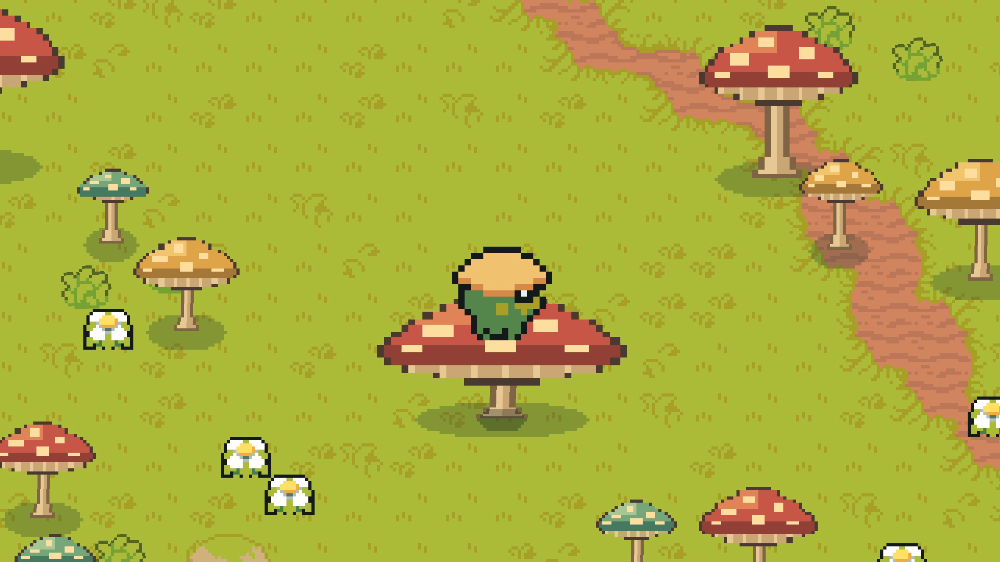
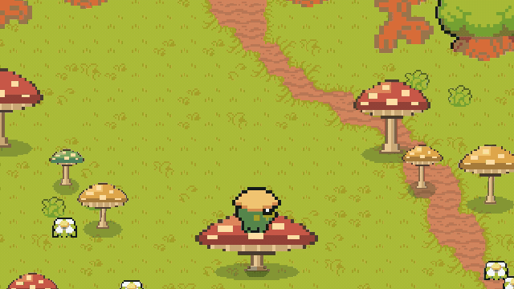

# 蘑菇草坪 · Godot 2D 像素交互

踩一踩，软乎乎；蓄满力，再把自己弹起来。



这是视频里那片可以踩压、蓄力弹射、向周围蘑菇传递波动的草坪。地面由可编辑的 `TileMapLayer` 搭建，角色、树木和蘑菇是独立节点。伞盖与菌柄共用连接点，菌柄基部固定在地面。

**纯 2D · GDScript · 无插件依赖 · 已在 Godot 4.7.2 Standard 验证。** 内部画布640×360，最近邻、整数倍像素缩放。无需 .NET、Python 或联网下载资源即可运行游戏。



## 下载与运行

### 只想试玩：Windows 一键包

从 [Releases](https://github.com/GGBond2424648901/godot-mushroom-meadow/releases/latest) 下载 `godot-mushroom-meadow-v1.0.0-windows-portable.zip`，**先完整解压，再双击 `Launch.cmd`**。内含官方Godot 4.7.2引擎，首次启动会自动导入资源，稍等片刻进入场景。

这是“Godot引擎 + 源工程”的便携包，方便直接试玩和编辑；不是导出的独立游戏EXE。Windows 10/11、64位；渲染器为Compatibility，使用系统默认音频设备。

### 想看代码：源码工程

1. 安装 [Godot 4.7.2 Standard](https://godotengine.org/download/archive/4.7.2-stable/)；其他版本未经本仓库验证。
2. 下载 [源码ZIP](https://github.com/GGBond2424648901/godot-mushroom-meadow/releases/download/v1.0.0/godot-mushroom-meadow-v1.0.0-source.zip)，或 `git clone https://github.com/GGBond2424648901/godot-mushroom-meadow.git`。
3. 在Godot项目管理器中导入根目录 `project.godot`，等待资源导入后按 **F6运行 `scenes/meadow.tscn`**，或按 **F5运行项目**。

Windows也可指定本机Godot：

```powershell
powershell -NoProfile -ExecutionPolicy Bypass -File .\Launch.ps1 -GodotPath 'D:\Godot\Godot_v4.7.2-stable_win64_console.exe'
```

或者将Godot可执行文件的完整路径放入环境变量 `GODOT_BIN`。源工程ZIP不附引擎；中文字体和所需美术已包含在内。

macOS/Linux可在编辑器导入；如果已安装命令行Godot，可运行：

```sh
GODOT_BIN=/path/to/godot sh ./run.sh
```

本次实测平台为Windows 11；macOS/Linux启动脚本已提供，未在对应平台实测。

## 怎么玩

| 按键 | 作用 |
|---|---|
| WASD / 方向键 | 走动，直接走上菌盖 |
| Shift | 奔跑 |
| Space | 普通跳跃；站在蘑菇上会弹跳 |
| **按住 E，再松开** | 在菌盖上站稳后蓄力、弹射；大蘑菇蓄满力更高 |
| Tab | 自动演示，移动或E可接管 |
| R | 重置角色、弹簧、孢子、水纹和待执行波动 |
| M | 音效开关 |

先走到中央大红蘑菇，停稳，按住E约1秒再松开。落地会再次压动菌盖，周围蘑菇按距离稍晚、稍轻地回应。

## 交互代码在哪里

| 文件 | 负责什么 |
|---|---|
| [`src/spring.gd`](src/spring.gd) | 弹簧、阻尼、小步积分和压缩边界 |
| [`src/mushroom.gd`](src/mushroom.gd) | 菌盖形变、盖柄连接、支撑判定、压缩量换弹射高度 |
| [`src/traveler.gd`](src/traveler.gd) | 平面移动、独立高度、重力、落地、起跳速度和影子 |
| [`src/meadow.gd`](src/meadow.gd) | 输入、蓄力释放、落地冲击、邻近延迟队列和重置 |
| [`src/effects.gd`](src/effects.gd) | 孢子与水纹 |
| [`src/sound.gd`](src/sound.gd) | 运行时合成弹跳音效，无外部音频依赖 |
| [`src/pixel_mushroom.gd`](src/pixel_mushroom.gd) | 代码定义的蘑菇像素造型 |
| [`scenes/terrain.tscn`](scenes/terrain.tscn) | Grass / Footpath / Water三层可编辑瓦片 |

从 [`docs/INTERACTION.md`](docs/INTERACTION.md) 按“踩压→形变→支撑→弹起→邻近响应”的顺序读，有实际代码片段和参数解释。

想改手感：调整 `mushroom.gd` 的 `spring.stiffness`、`spring.damping`、`bounce_rise()`；想改造型：在蘑菇节点的Inspector调整 `species`、`cap_width`、`stalk_height`。`tools/build_layout.py`与`tools/build_terrain.gd`可重新生成固定布局，会覆盖手工编辑的TSCN，运行游戏不需要执行它们。

## 美术和许可

- **工程代码与本工程制作的代码像素造型、音效：MIT**，见 [`LICENSE`](LICENSE)。
- **人物、地面、树木、花草等基础美术：Pixel-Boy 与 AAA 的 [Ninja Adventure](https://pixel-boy.itch.io/ninja-adventure-asset-pack)，CC0-1.0。** PNG保持上游原字节，来源路径、固定提交与哈希见 [`assets/cc0/ninja-adventure/receipt.json`](assets/cc0/ninja-adventure/receipt.json)。
- **中文字体：Noto Sans SC，SIL OFL 1.1**，见 [`assets/fonts/OFL.txt`](assets/fonts/OFL.txt)。
- **便携包的Godot引擎：MIT及其依赖各自许可**，完整声明见 [`licenses/`](licenses/)；引擎二进制只在便携下载中。

详细范围与上游链接见 [`THIRD_PARTY_NOTICES.md`](THIRD_PARTY_NOTICES.md)。MIT不替代第三方素材和字体原有许可。场景不是一整张生成贴图；宣传封面基于实机帧添加文字，与运行时资源分开。

## 验证与打包

```sh
godot --headless --editor --path . --import
godot --headless --path . --script res://tests/smoke.gd
```

测试覆盖资源加载、可编辑瓦片、E蓄力释放、实际起跳高度、盖柄连接与重置。Windows可运行 `Launch.ps1 -GodotPath '完整路径' -Smoke`。

仓库中的 `tools/make_release.py` 仅供维护者打包，需要Python 3和Git；游戏本身不依赖它。构建与验证记录见 [`docs/RELEASE.md`](docs/RELEASE.md)，发布标题、简介和评论区文案见 [`docs/PUBLISHING.md`](docs/PUBLISHING.md)。
